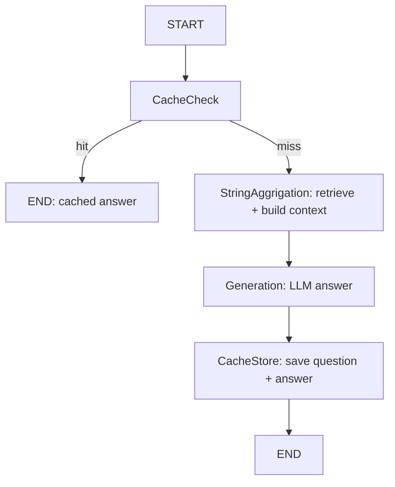

# Semantic Cache for Pharma Study RAG

A RAG pipeline over clinical-trial PDFs (e.g. TECOS, EMPA-REG) with a **semantic cache** in front of the LLM. Repeated or paraphrased questions are answered from Redis in milliseconds instead of running retrieval and generation again.

## How it works



1. **CacheCheck** embeds the question and looks for a similar past question in Redis (cosine distance below a threshold).
2. **Hit**: the stored answer is returned and retrieval and the LLM are skipped.
3. **Miss**: relevant chunks are retrieved from Chroma, the LLM answers from that context only, and the new question-answer pair is stored with a TTL.
4. Tune the thresold to a point which gives the best precision, by ploting the tpr and fpr 
   


Per-question counters (`stats:asked`, `stats:hits`) are kept in Redis sorted sets so you can see which questions are asked most and which are served from cache.

## Stack

| Part | Tool |
|---|---|
| Orchestration | LangGraph |
| Document loading / splitting | LangChain (`PyMuPDFLoader`, `RecursiveCharacterTextSplitter`) |
| Embeddings | `sentence-transformers/all-MiniLM-L6-v2` (local) |
| Vector store | Chroma (persisted on disk) |
| Semantic cache | RedisVL `SemanticCache` on Azure Managed Redis |
| LLM | OpenAI-compatible chat model (`gpt-4.1-mini`) |

## Setup

```bash
pip install langchain-community langchain-text-splitters langchain-chroma \
            langchain-huggingface langchain-openai langgraph \
            sentence-transformers redisvl redis python-dotenv pymupdf
```

Create a `.env` file (never commit it):

```
REDIS_HOST=<name>.<region>.redis.azure.net   # no port
REDIS_KEY=<primary access key>
OPENAI_API_KEY=<your key>
```

Notes for Azure Managed Redis:
- Create the cache with the **RediSearch** module, **Enterprise** clustering policy and **NoEviction** eviction policy (RediSearch is required for vector search and cannot be added later).
- The connection uses TLS on port `10000`: `rediss://:<url-encoded-key>@<host>:10000`.

## Run

```python
result = app.invoke({"question": "What is the primary outcome of the TECOS study?"})
print(result["cache_hit"], result["answer"])   # first call: False
result = app.invoke({"question": "What is the primary outcome of the TECOS study?"})
print(result["cache_hit"], result["answer"])   # second call: True

show_stats()   # most asked questions and most cache hits
```

## Tuning the cache

- `distance_threshold` (cosine distance, lower = stricter) is the key setting. A false hit returns a confident but wrong answer, which matters for clinical content, so start strict (around 0.1) and tune on your own data.
- Build 50-100 test pairs: paraphrases that should hit, and hard negatives that should not (for example "metformin dose" vs "metformin side effects"). Pick the threshold with near-zero false hits.
- If you change the embedding model, rebuild the cache.
- `ttl` controls expiry. Clear the cache when the underlying documents change.

## Repo hygiene

Add the vector store and secrets to `.gitignore`:

```
.env
db/chorma_db/
```

## Results

| Metric | Value |
|---|---|
| Cache miss latency | _fill in_ |
| Cache hit latency | _fill in_ |
| False-hit rate at chosen threshold | _fill in_ |
